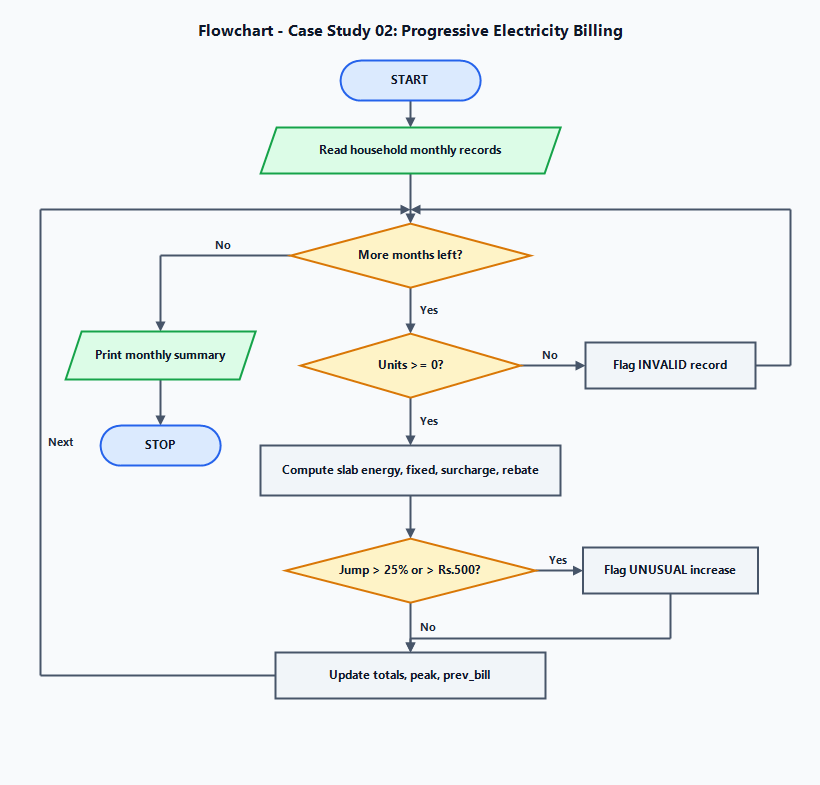
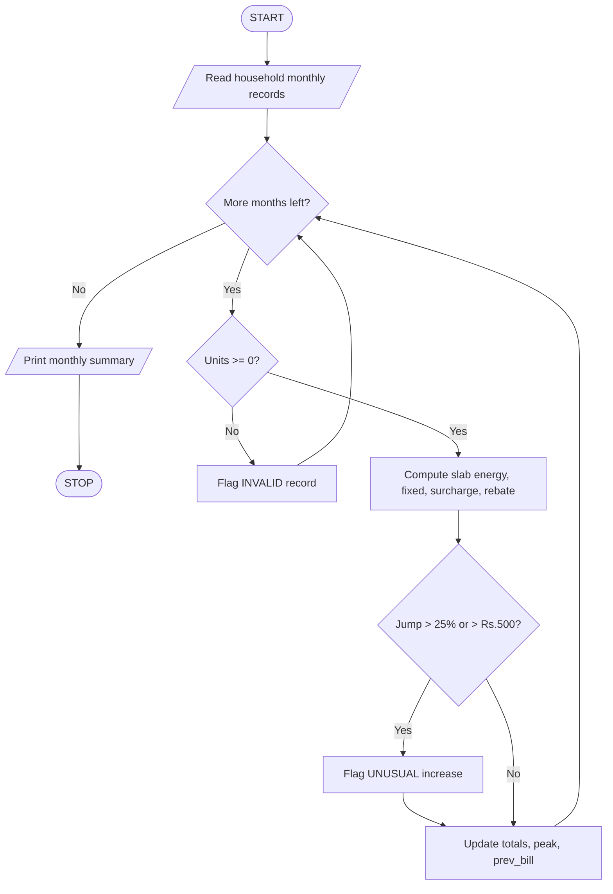
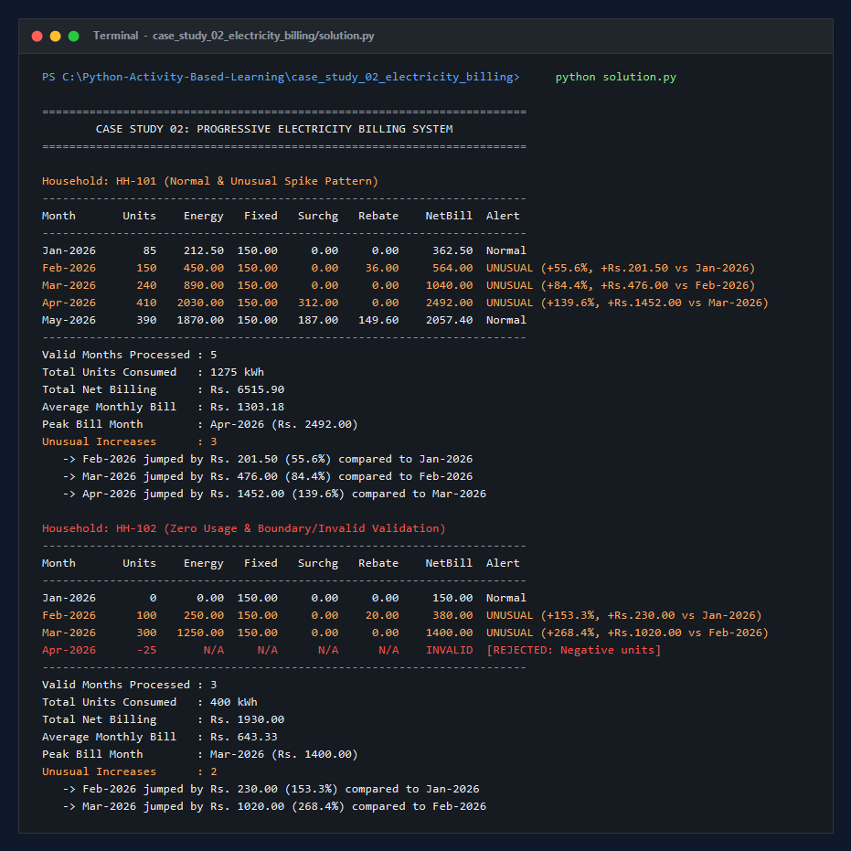

# Case Study 02: Progressive Electricity Billing

## 1. Problem Statement
Design and implement a Python program to calculate monthly household electricity bills using progressive unit-consumption slabs, fixed meter charges, high-usage and late-payment surcharges, and solar/early-payment rebates. The system must compare consecutive monthly bills for a household, validate invalid (negative) meter readings, and identify unusual month-over-month bill increases.

---

## 2. Objectives
- Compute energy charges accurately across four progressive consumption slabs (`0–100`, `101–200`, `201–350`, and `>350` units).
- Apply fixed meter charges, conditional surcharges (high consumption `>300` units and late payment), and solar rebates (`8%` on energy charges when usage `>0`).
- Validate input readings and reject negative unit values without halting remaining records.
- Track consecutive monthly bills to detect unusual increases (`>25%` percentage jump or `>Rs. 500` absolute increase) and summarize total units, average bill, and peak billing month.

---

## 3. Assumptions
- Consumption slabs are progressive (marginal):
  - `0–100` units: `Rs. 2.50 / unit`
  - `101–200` units: `Rs. 4.00 / unit`
  - `201–350` units: `Rs. 6.00 / unit`
  - `> 350` units: `Rs. 8.00 / unit`
- Fixed meter charge is `Rs. 150.00` per valid month (even at `0` units).
- High-usage surcharge is `10%` of energy charge when `units > 300`; late-payment fee is `5%` of `(energy_charge + fixed_charge)`.
- Solar rebate is `8%` of energy charge when eligible and `units > 0`.
- An increase is flagged **UNUSUAL** if the bill rises by more than `25%` or more than `Rs. 500.00` compared to the previous valid month.

---

## 4. Algorithm
1. **Start** and initialize constants (`FIXED_CHARGE = 150.0`, slab rates, surcharge/rebate rates, and unusual-increase thresholds).
2. Load household datasets, each containing monthly tuples `(month_name, units, has_solar, is_late)`.
3. For each household, initialize accumulators (`total_net_bill`, `total_units`, `highest_bill`, `prev_bill = None`, `unusual_months = []`).
4. Iterate over each monthly tuple and unpack `(month_name, units, has_solar, is_late)`.
5. If `units < 0`, display an `INVALID` rejection message and continue to the next month.
6. Compute `energy_charge` progressively across the four slabs using conditional subtraction on `remaining`.
7. Add `10%` high-usage surcharge if `units > 300`, add `5%` late fee if `is_late` is `True`, and subtract `8%` solar rebate if `has_solar` and `units > 0`.
8. Calculate `net_bill = round(energy_charge + FIXED_CHARGE + surcharge - rebate, 2)`.
9. If `prev_bill` exists, compute `diff = net_bill - prev_bill` and percentage increase; if `pct_change > 25.0` or `diff > 500.0`, flag the month as `UNUSUAL` and append details to `unusual_months`.
10. Update `total_net_bill`, `total_units`, `highest_bill`, and `prev_bill`.
11. After processing all months, print the household billing summary and **Stop**.

---

## 5. Flowchart





---

## 6. Pseudocode
```text
BEGIN
    SET FIXED_CHARGE = 150.0
    FOR each household IN test_households DO
        SET prev_bill = NULL, total_net_bill = 0, total_units = 0, highest_bill = -1
        SET unusual_months = []

        FOR each record IN monthly_records DO
            UNPACK (month_name, units, has_solar, is_late) FROM record
            IF units < 0 THEN
                PRINT month_name, "INVALID [Negative units]"
                CONTINUE
            ENDIF

            SET energy_charge = 0, remaining = units
            IF remaining > 350 THEN
                energy_charge = energy_charge + (remaining - 350) * 8.00
                remaining = 350
            ENDIF
            IF remaining > 200 THEN
                energy_charge = energy_charge + (remaining - 200) * 6.00
                remaining = 200
            ENDIF
            IF remaining > 100 THEN
                energy_charge = energy_charge + (remaining - 100) * 4.00
                remaining = 100
            ENDIF
            IF remaining > 0 THEN
                energy_charge = energy_charge + remaining * 2.50
            ENDIF

            SET surcharge = 0, rebate = 0
            IF units > 300 THEN surcharge = surcharge + energy_charge * 0.10 ENDIF
            IF is_late THEN surcharge = surcharge + (energy_charge + FIXED_CHARGE) * 0.05 ENDIF
            IF has_solar AND units > 0 THEN rebate = energy_charge * 0.08 ENDIF

            SET net_bill = ROUND(energy_charge + FIXED_CHARGE + surcharge - rebate, 2)

            IF prev_bill IS NOT NULL AND prev_bill > 0 THEN
                SET diff = net_bill - prev_bill
                SET pct = (diff / prev_bill) * 100
                IF pct > 25.0 OR diff > 500.0 THEN
                    APPEND (month_name, prev_month, pct, diff) TO unusual_months
                ENDIF
            ENDIF

            UPDATE total_net_bill, total_units, highest_bill, prev_bill
        ENDFOR
        PRINT household summary
    ENDFOR
END
```

---

## 7. Python Source Code
- Source file: [`solution.py`](solution.py)
- **Syllabus concepts applied:** Variables, `int`/`float`/`bool`/`str` data types, arithmetic & logical operators, `if`/`elif` conditional slabs, `for` loops, lists, tuples, and tuple unpacking.

---

## 8. Test Cases

| Test ID | Input `(Month, Units, Solar, Late)` | Expected Behaviour | Observed Output | Status |
| :--- | :--- | :--- | :--- | :--- |
| TC01 | `("Jan-2026", 85, False, False)` | Slab 1 energy `212.50` + Fixed `150.00` = `Rs. 362.50` (`Normal`) | `NetBill = 362.50`, `Normal` | PASS |
| TC02 | `("Feb-2026", 150, True, False)` | Energy `450.00`, Rebate `36.00`, Net `564.00`, flagged `UNUSUAL` (`+55.6%`) | `NetBill = 564.00`, `UNUSUAL (+55.6%)` | PASS |
| TC03 | `("Apr-2026", 410, False, True)` | All 4 slabs + 10% high-usage + 5% late fee = `2492.00`, `UNUSUAL` | `NetBill = 2492.00`, `UNUSUAL (+139.6%)` | PASS |
| TC04 | `("Jan-2026", 0, False, False)` | Zero energy, Fixed `150.00`, no rebate | `NetBill = 150.00`, `Normal` | PASS |
| TC05 | `("Apr-2026", -25, False, False)` | Rejected as invalid negative units | `INVALID [REJECTED: Negative units]` | PASS |

---

## 9. Output Screenshots



---

## 10. Conclusion
The Progressive Electricity Billing system accurately computes multi-slab electricity charges, fixed fees, conditional surcharges, and solar rebates while safely rejecting invalid meter readings. By comparing consecutive monthly bills using loops and tuple unpacking, it effectively flags unusual consumption spikes and summarizes household usage.
