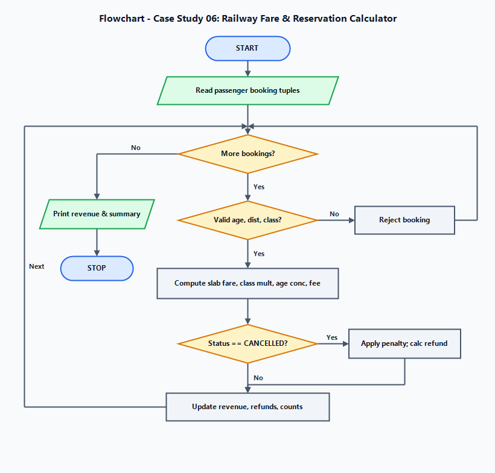
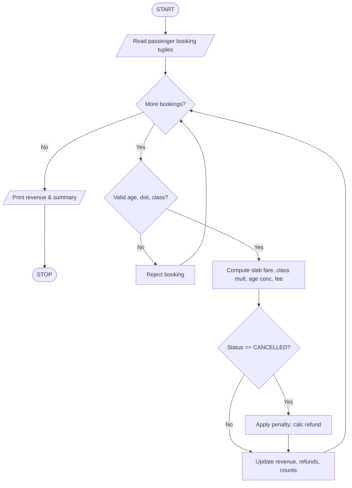
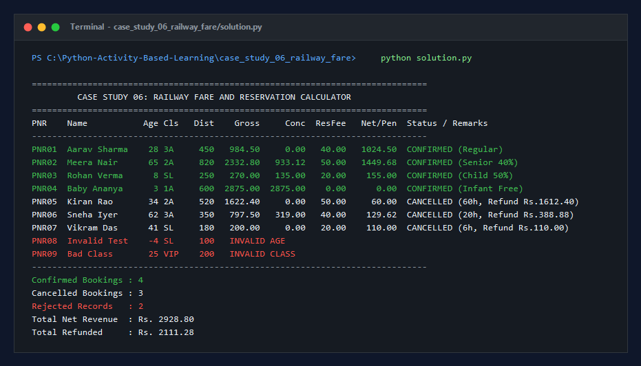

# Case Study 06: Railway Fare and Reservation Calculator

## 1. Problem Statement
Develop a Python application to calculate railway ticket fares for multiple passengers using progressive distance slabs, travel class multipliers (`SL`, `3A`, `2A`, `1A`), age-based concessions, fixed reservation fees, and time-tiered cancellation penalties, while validating passenger and journey inputs.

---

## 2. Objectives
- Calculate progressive base railway fares across distance slabs (`1–100`, `101–300`, `301–600`, and `>600` km).
- Scale fares by travel class multipliers and add class-specific reservation charges.
- Apply age-based concessions (Infants `<5` free, Children `5–11` `50%` off, Seniors `>=60` `40%` off).
- Compute cancellation penalties and refund amounts based on hours remaining before departure, while rejecting invalid ages, distances, or classes.

---

## 3. Assumptions
- Distance slab base rates (Sleeper equivalent):
  - `1–100 km`: `Rs. 1.20 / km`
  - `101–300 km`: `Rs. 1.00 / km`
  - `301–600 km`: `Rs. 0.85 / km`
  - `> 600 km`: `Rs. 0.70 / km`
- Class multipliers and reservation fees: `SL (1.0x, Rs. 20)`, `3A (2.2x, Rs. 40)`, `2A (3.2x, Rs. 50)`, `1A (5.0x, Rs. 60)`.
- Infants (`age < 5`) travel completely free with zero reservation fee.
- Cancellation penalties on `ticket_total`: `>= 48h` flat `Rs. 60` clerkage; `12–47h` `25%`; `1–11h` `50%`; `<= 0h` `100%` (no refund).

---

## 4. Algorithm
1. **Start** and load the list of passenger booking tuples `(pnr, name, age, travel_class, distance, status, hours_before)`.
2. Initialize totals: `total_collected = 0.0`, `total_refunded = 0.0`, `confirmed_count = 0`, `cancelled_count = 0`, `rejected_count = 0`.
3. For each booking tuple, unpack all seven fields.
4. Validate `0 <= age <= 120`, `distance > 0`, and `travel_class in ("SL", "3A", "2A", "1A")`. If invalid, increment `rejected_count`, print the error, and continue.
5. Compute `base_fare` progressively across the distance slabs.
6. Multiply `base_fare` by the class multiplier and assign `res_fee` based on `travel_class`.
7. Determine `concession` using `age` (`<5`, `5–11`, `>=60`, or regular) and compute `ticket_total = round((class_fare - concession) + res_fee, 2)`.
8. If `status == "CONFIRMED"`, add `ticket_total` to `total_collected` and print the confirmed breakdown.
9. If `status == "CANCELLED"`, determine `penalty` from `hours_before`, compute `refund = ticket_total - penalty`, update totals, and print cancellation details.
10. After processing all bookings, display summary counts, total net revenue, and total refunds, then **Stop**.

---

## 5. Flowchart





---

## 6. Pseudocode
```text
BEGIN
    SET total_collected = 0, total_refunded = 0
    FOR each booking IN bookings DO
        UNPACK (pnr, name, age, travel_class, distance, status, hours_before)
        IF age < 0 OR age > 120 OR distance <= 0 OR travel_class NOT IN ("SL","3A","2A","1A") THEN
            PRINT pnr, "INVALID"
            INCREMENT rejected_count
            CONTINUE
        ENDIF

        COMPUTE base_fare using distance slabs
        SET (multiplier, res_fee) based on travel_class
        SET class_fare = base_fare * multiplier

        IF age < 5 THEN concession = class_fare; res_fee = 0
        ELSE IF age <= 11 THEN concession = class_fare * 0.50
        ELSE IF age >= 60 THEN concession = class_fare * 0.40
        ELSE concession = 0
        ENDIF

        SET ticket_total = ROUND((class_fare - concession) + res_fee, 2)

        IF status == "CONFIRMED" THEN
            total_collected = total_collected + ticket_total
        ELSE IF status == "CANCELLED" THEN
            COMPUTE penalty from hours_before
            SET refund = ROUND(ticket_total - penalty, 2)
            total_collected = total_collected + penalty
            total_refunded = total_refunded + refund
        ENDIF
    ENDFOR
    PRINT booking counts, total_collected, total_refunded
END
```

---

## 7. Python Source Code
- Source file: [`solution.py`](solution.py)
- **Syllabus concepts applied:** Variables, numeric & string data types, relational/membership operators, `if`/`elif`/`else` branching, `for` loop, lists, tuples, and tuple unpacking.

---

## 8. Test Cases

| Test ID | Passenger Case | Expected Result | Observed Output | Status |
| :--- | :--- | :--- | :--- | :--- |
| TC01 | `PNR01`: Age 28, `3A`, 450 km, Confirmed | Slab base `447.50 * 2.2 + 40 = 1024.50` | `Net = 1024.50`, `CONFIRMED (Regular)` | PASS |
| TC02 | `PNR02`: Age 65, `2A`, 820 km, Confirmed | Senior 40% off `2332.80` + `50 = 1449.68` | `Net = 1449.68`, `CONFIRMED (Senior 40%)` | PASS |
| TC03 | `PNR04`: Age 3, `1A`, 600 km, Confirmed | Infant free (`0.00` fare, `0.00` fee) | `Net = 0.00`, `CONFIRMED (Infant Free)` | PASS |
| TC04 | `PNR05`: Age 34, `2A`, 520 km, Cancelled 60h | Flat `60.00` penalty, `1612.40` refund | `Pen = 60.00`, `Refund Rs.1612.40` | PASS |
| TC05 | `PNR08`/`PNR09`: Age `-4` and Class `VIP` | Rejected with validation errors | `INVALID AGE`, `INVALID CLASS` | PASS |

---

## 9. Output Screenshots



---

## 10. Conclusion
The Railway Fare and Reservation Calculator cleanly models real-world multi-slab railway pricing, class scaling, age concessions, and tiered cancellation refunds using tuple unpacking and conditional branching while safeguarding against invalid inputs.
