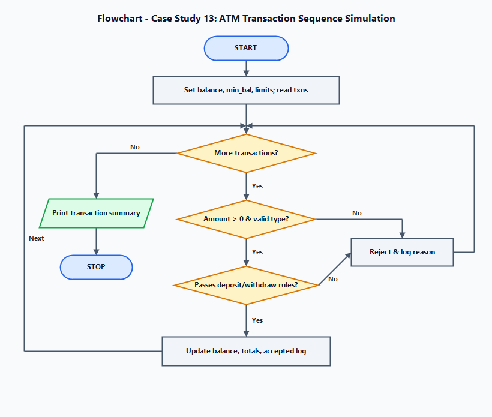
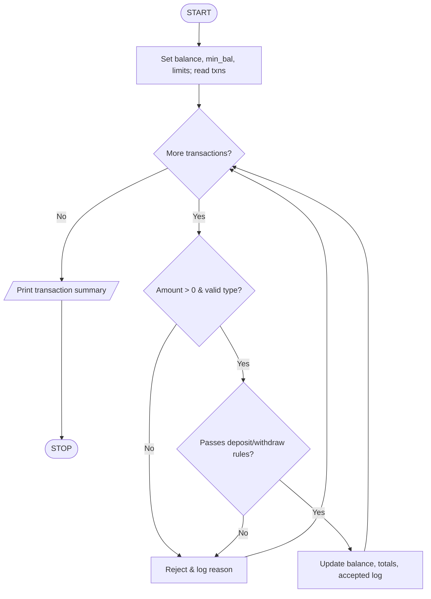
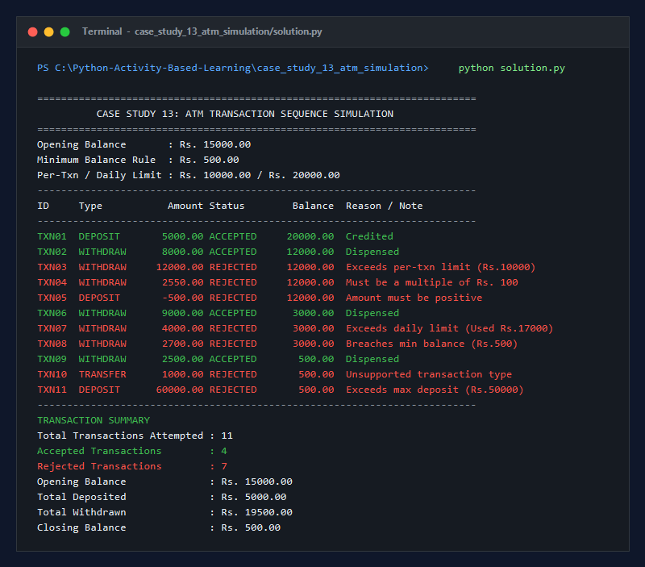

# Case Study 13: ATM Transaction Sequence Simulation

## 1. Problem Statement
Build a Python program that simulates a sequence of ATM deposits and withdrawals on a bank account, maintaining the running balance, enforcing minimum balance and withdrawal limits, rejecting invalid transactions with clear reasons, and printing an itemized transaction summary.

---

## 2. Objectives
- Process sequential transaction tuples `(txn_id, txn_type, amount)` using a `while` loop and tuple unpacking.
- Enforce account constraints: positive amounts, withdrawal multiples of `Rs. 100`, maximum per-withdrawal limit (`Rs. 10,000`), daily withdrawal cap (`Rs. 20,000`), single deposit cap (`Rs. 50,000`), and minimum balance (`Rs. 500`).
- Record accepted and rejected transactions separately with explicit rejection reasons.
- Output a complete opening-to-closing balance reconciliation summary.

---

## 3. Assumptions
- Opening balance is `Rs. 15,000.00` and minimum balance is `Rs. 500.00`.
- Only `"DEPOSIT"` and `"WITHDRAW"` (case-insensitive) are valid transaction types.
- Withdrawals must be strictly positive, divisible by `100`, `<= Rs. 10,000` per transaction, and keep cumulative daily withdrawals `<= Rs. 20,000` without dropping the balance below `Rs. 500`.

---

## 4. Algorithm
1. **Start** and initialize account parameters (`opening_balance = 15000.0`, `MIN_BALANCE = 500.0`, `MAX_PER_WITHDRAWAL = 10000.0`, `MAX_DAILY_WITHDRAWAL = 20000.0`, `MAX_SINGLE_DEPOSIT = 50000.0`).
2. Initialize `balance = opening_balance`, `daily_withdrawn = 0.0`, `total_deposited = 0.0`, `accepted_log = []`, and `rejected_log = []`.
3. Loop through `transactions` with index `idx` and unpack `(txn_id, txn_type, amount)`.
4. Normalize `clean_type = txn_type.strip().upper()`.
5. If `amount <= 0`, reject the transaction (`"Amount must be positive"`) and continue.
6. If `clean_type == "DEPOSIT"`: reject if `amount > MAX_SINGLE_DEPOSIT`; otherwise add `amount` to `balance` and `total_deposited`, and log as `ACCEPTED`.
7. If `clean_type == "WITHDRAW"`: validate `amount % 100 == 0`, `amount <= MAX_PER_WITHDRAWAL`, `daily_withdrawn + amount <= MAX_DAILY_WITHDRAWAL`, and `balance - amount >= MIN_BALANCE`. If all pass, deduct from `balance`, add to `daily_withdrawn`, and log as `ACCEPTED`; otherwise reject with the first violated rule.
8. If `clean_type` is unrecognized, reject as `"Unsupported transaction type"`.
9. After all transactions finish, print the summary report and **Stop**.

---

## 5. Flowchart





---

## 6. Pseudocode
```text
BEGIN
    SET balance = 15000.0, daily_withdrawn = 0.0, total_deposited = 0.0
    SET idx = 0
    WHILE idx < LENGTH(transactions) DO
        UNPACK (txn_id, txn_type, amount) FROM transactions[idx]
        idx = idx + 1
        clean_type = UPPER(STRIP(txn_type))

        IF amount <= 0 THEN
            LOG_REJECT(txn_id, "Amount must be positive")
            CONTINUE
        ENDIF

        IF clean_type == "DEPOSIT" THEN
            IF amount > 50000 THEN
                LOG_REJECT(txn_id, "Exceeds max deposit")
            ELSE
                balance = balance + amount
                total_deposited = total_deposited + amount
                LOG_ACCEPT(txn_id, balance)
            ENDIF
        ELSE IF clean_type == "WITHDRAW" THEN
            IF amount MOD 100 != 0 THEN LOG_REJECT(txn_id, "Not multiple of 100")
            ELSE IF amount > 10000 THEN LOG_REJECT(txn_id, "Exceeds per-txn limit")
            ELSE IF daily_withdrawn + amount > 20000 THEN LOG_REJECT(txn_id, "Exceeds daily limit")
            ELSE IF balance - amount < 500 THEN LOG_REJECT(txn_id, "Breaches min balance")
            ELSE
                balance = balance - amount
                daily_withdrawn = daily_withdrawn + amount
                LOG_ACCEPT(txn_id, balance)
            ENDIF
        ELSE
            LOG_REJECT(txn_id, "Unsupported transaction type")
        ENDIF
    ENDWHILE
    PRINT summary totals
END
```

---

## 7. Python Source Code
- Source file: [`solution.py`](solution.py)
- **Syllabus concepts applied:** Variables, numeric & string methods (`.strip()`, `.upper()`), modulo and relational operators, nested `if`/`elif`/`else`, `while` loop, lists, tuples, and tuple unpacking.

---

## 8. Test Cases

| Test ID | Transaction Tuple | Expected Outcome | Observed Output | Status |
| :--- | :--- | :--- | :--- | :--- |
| TC01 | `("TXN01", "DEPOSIT", 5000.0)` | Accepted; balance becomes `20000.00` | `ACCEPTED`, `Balance = 20000.00` | PASS |
| TC02 | `("TXN03", "WITHDRAW", 12000.0)` | Rejected (`> 10000` per-txn limit) | `REJECTED (Exceeds per-txn limit)` | PASS |
| TC03 | `("TXN04", "WITHDRAW", 2550.0)` | Rejected (not multiple of `100`) | `REJECTED (Must be a multiple of Rs. 100)` | PASS |
| TC04 | `("TXN07", "WITHDRAW", 4000.0)` | Rejected (daily limit `17000 + 4000 > 20000`) | `REJECTED (Exceeds daily limit)` | PASS |
| TC05 | `("TXN08", "WITHDRAW", 2700.0)` | Rejected (`3000 - 2700 < 500` min balance) | `REJECTED (Breaches min balance)` | PASS |
| TC06 | `("TXN09", "WITHDRAW", 2500.0)` | Accepted; exact `500.00` min balance | `ACCEPTED`, `Balance = 500.00` | PASS |

---

## 9. Output Screenshots



---

## 10. Conclusion
The ATM Transaction Sequence Simulation reliably enforces multi-layered banking rules (denomination, per-transaction, daily limit, and minimum balance) in real time across sequential operations, rejecting invalid transactions cleanly without corrupting account state.
