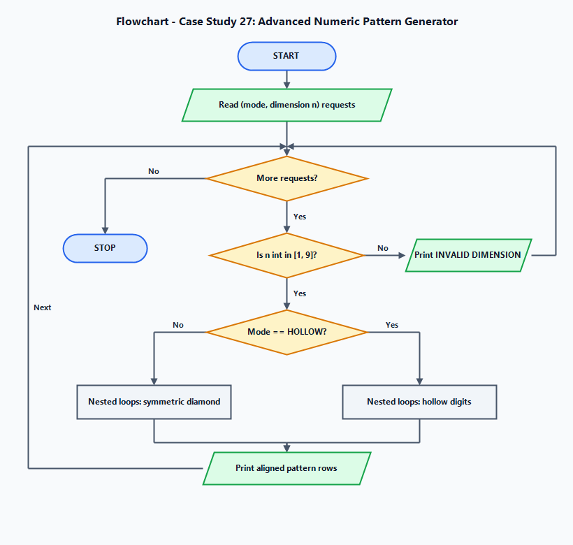
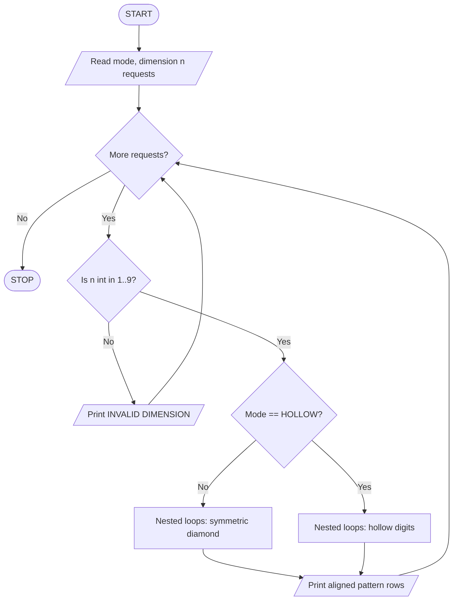
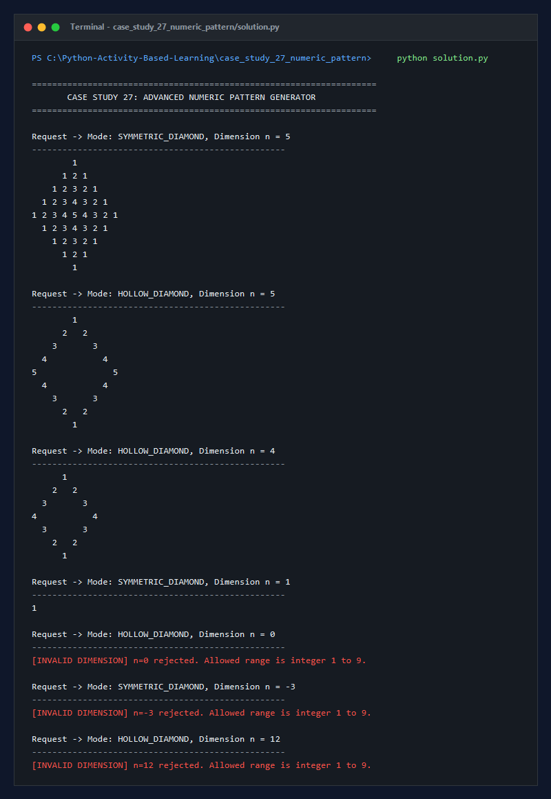

# Case Study 27: Advanced Numeric Pattern Generator

## 1. Problem Statement
Create a Python program that generates both symmetric numeric diamonds and hollow numeric diamonds based on user-specified dimension `n`, validating invalid dimensions (`n < 1`, `n > 9`, or non-integers) and producing cleanly aligned monospace output using nested loops.

---

## 2. Objectives
- Validate dimension inputs so only single-digit positive integers (`1 <= n <= 9`) are accepted for aligned rendering.
- Generate a **Symmetric Numeric Diamond** where each row `r` displays `1 2 ... r ... 2 1` mirrored top-to-bottom.
- Generate a **Hollow Numeric Diamond** where only outer boundary digits (`1` to `n` and back to `1`) are printed with exact inner spacing.
- Handle edge cases (`n = 1`, even `n = 4`, odd `n = 5`, `n = 0`, negative `n = -3`, and oversized `n = 12`).

---

## 3. Assumptions
- Valid pattern dimension `n` must be an integer in the range `1` to `9` so every digit occupies one character width for clean alignment.
- Two pattern modes are supported: `"SYMMETRIC_DIAMOND"` and `"HOLLOW_DIAMOND"`.
- Leading alignment uses two spaces (`"  "`) per column offset, and inner gaps in the hollow diamond use `(2 * row_val) - 3` double spaces plus a single separator space.

---

## 4. Algorithm
1. **Start** and define test requests as tuples `(mode, n)`.
2. For each request, unpack `(mode, n)` and print the request header.
3. Validate `type(n) is int` and `1 <= n <= 9`. If invalid, print `[INVALID DIMENSION]` and continue to the next request.
4. If `mode == "SYMMETRIC_DIAMOND"`:
   - Loop `row` from `1` to `n` (upper half) and then `n - 1` down to `1` (lower half).
   - Print `(n - row)` double-spaces, ascending digits `1..row`, and descending digits `(row - 1)..1`.
5. If `mode == "HOLLOW_DIAMOND"`:
   - Loop `i` from `1` to `2 * n - 1`.
   - Compute `row_val = i` if `i <= n`, else `2 * n - i`.
   - Print `(n - row_val)` double-spaces.
   - If `row_val == 1`, print `"1"`; otherwise print `row_val`, `(2 * row_val - 3)` double-spaces, `" "`, and `row_val`.
6. Repeat for all requests and **Stop**.

---

## 5. Flowchart





---

## 6. Pseudocode
```text
BEGIN
    FOR each (mode, n) IN test_requests DO
        IF n IS NOT INTEGER OR n < 1 OR n > 9 THEN
            PRINT "[INVALID DIMENSION]"
            CONTINUE
        ENDIF

        IF mode == "SYMMETRIC_DIAMOND" THEN
            FOR row = 1 TO n DO
                BUILD line with (n - row) * "  ", digits 1..row, digits (row-1)..1
                PRINT line
            ENDFOR
            FOR row = n - 1 DOWNTO 1 DO
                BUILD line with (n - row) * "  ", digits 1..row, digits (row-1)..1
                PRINT line
            ENDFOR
        ELSE IF mode == "HOLLOW_DIAMOND" THEN
            SET total_rows = 2 * n - 1
            FOR i = 1 TO total_rows DO
                row_val = i IF i <= n ELSE total_rows - i + 1
                line = (n - row_val) * "  "
                IF row_val == 1 THEN
                    line = line + "1"
                ELSE
                    line = line + STR(row_val) + ((2 * row_val - 3) * "  ") + " " + STR(row_val)
                ENDIF
                PRINT line
            ENDFOR
        ENDIF
    ENDFOR
END
```

---

## 7. Python Source Code
- Source file: [`solution.py`](solution.py)
- **Syllabus concepts applied:** Variables, `int` and `str` types, nested `for` loops, `range()` with positive and negative steps, conditional branching, string concatenation, `.rstrip()`, tuples, and tuple unpacking.

---

## 8. Test Cases

| Test ID | Input `(Mode, n)` | Expected Behaviour | Observed Output | Status |
| :--- | :--- | :--- | :--- | :--- |
| TC01 | `("SYMMETRIC_DIAMOND", 5)` | 9-row symmetric numeric diamond peaking at `1 2 3 4 5 4 3 2 1` | 9 aligned symmetric rows | PASS |
| TC02 | `("HOLLOW_DIAMOND", 5)` | 9-row hollow numeric diamond with outer digits `1..5..1` | 9 aligned hollow rows | PASS |
| TC03 | `("HOLLOW_DIAMOND", 4)` | 7-row even-dimension hollow diamond | 7 aligned hollow rows | PASS |
| TC04 | `("SYMMETRIC_DIAMOND", 1)` | Single-row base case printing `1` | `1` | PASS |
| TC05 | `("HOLLOW_DIAMOND", 0)`, `n=-3`, `n=12` | Rejected cleanly by dimension validator | `[INVALID DIMENSION]` message | PASS |

---

## 9. Output Screenshots



---

## 10. Conclusion
This case study demonstrates precise spatial reasoning and nested-loop control in Python. Both symmetric and hollow numeric diamonds align accurately across odd, even, and boundary dimensions while guarding against invalid dimension inputs.
