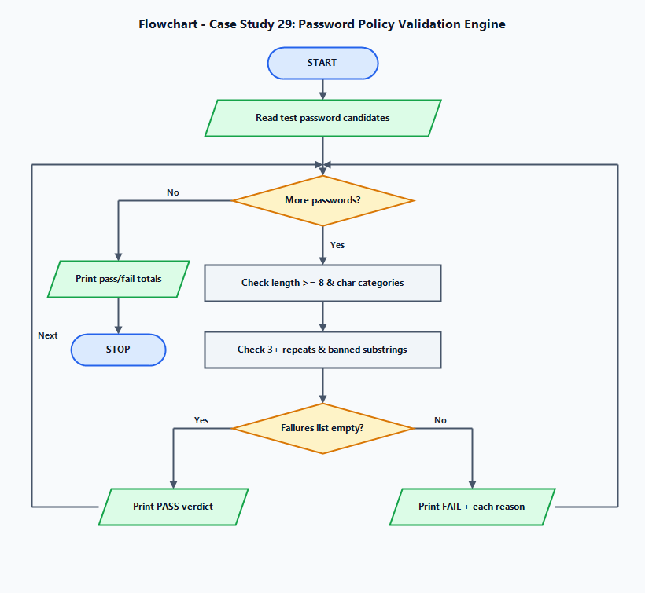
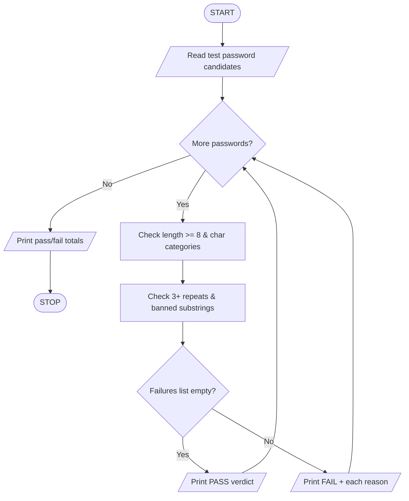
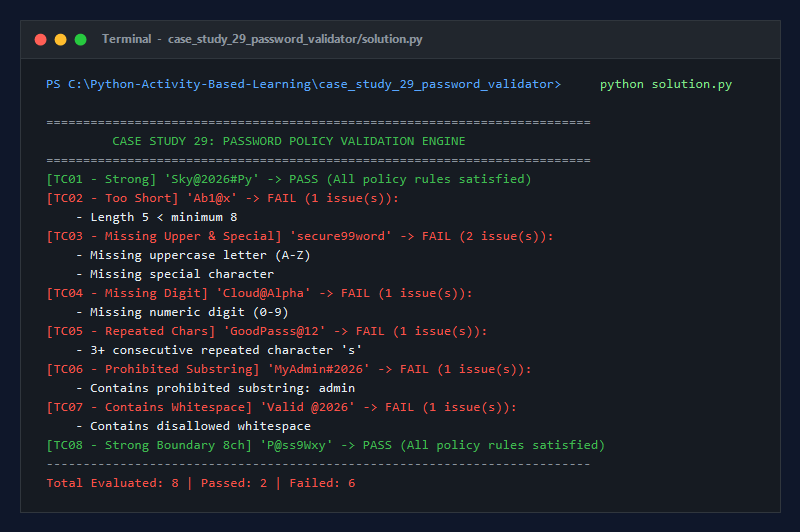

# Case Study 29: Password Policy Validation Engine

## 1. Problem Statement
Implement a Python password policy validation engine that evaluates candidate password strings against minimum length, character-category diversity (uppercase, lowercase, digit, special character), whitespace prohibition, consecutive repetition limits, and prohibited substrings, reporting every failed condition in detail.

---

## 2. Objectives
- Enforce minimum length (`>= 8` characters).
- Verify presence of at least one uppercase letter, lowercase letter, numeric digit, and special character, while disallowing spaces/tabs.
- Detect three or more identical consecutive characters (e.g., `"sss"`).
- Detect prohibited dictionary/common substrings (`"password"`, `"admin"`, `"1234"`, `"qwerty"`, `"welcome"`) case-insensitively and report all violated rules per password.

---

## 3. Assumptions
- Minimum required length is `8` characters.
- Allowed special character set is `"!@#$%^&*()-_+=.,?/:;"`.
- Maximum allowed identical consecutive characters is `2` (`3` or more consecutive repeats fail).
- Prohibited substrings are checked case-insensitively using `.lower()`.

---

## 4. Algorithm
1. **Start** and define policy constants (`MIN_LENGTH = 8`, `MAX_CONSECUTIVE_REPEAT = 2`, `SPECIAL_CHARS`, `PROHIBITED_SUBSTRINGS`).
2. Iterate through each test tuple `(label, pwd)` in `test_passwords`.
3. Initialize an empty `failures` list and boolean flags (`has_upper`, `has_lower`, `has_digit`, `has_special`, `has_space`).
4. Check `len(pwd) < MIN_LENGTH`; if true, append length failure message.
5. Loop through every character `ch` in `pwd` and update character-category flags using relational comparisons (`"A" <= ch <= "Z"`, etc.) and membership (`ch in SPECIAL_CHARS`).
6. Append a descriptive failure message for each missing category or detected whitespace.
7. If `len(pwd) >= 3`, scan adjacent characters to detect `> 2` consecutive repeats; if found, append repetition failure.
8. Convert `pwd` to lowercase and check each word in `PROHIBITED_SUBSTRINGS`; append any matched banned substrings.
9. If `len(failures) == 0`, mark `PASS`; otherwise mark `FAIL` and list every failed condition.
10. Print summary counts (`Total`, `Passed`, `Failed`) and **Stop**.

---

## 5. Flowchart





---

## 6. Pseudocode
```text
BEGIN
    SET MIN_LENGTH = 8, MAX_REPEAT = 2
    FOR each (label, pwd) IN test_passwords DO
        SET failures = []
        IF LENGTH(pwd) < MIN_LENGTH THEN APPEND "Length < 8" TO failures ENDIF

        SET has_upper = FALSE, has_lower = FALSE, has_digit = FALSE, has_special = FALSE, has_space = FALSE
        FOR each ch IN pwd DO
            UPDATE category flags based on character range / membership
        ENDFOR
        APPEND missing category messages and whitespace error TO failures

        SET run_count = 1
        FOR i = 1 TO LENGTH(pwd) - 1 DO
            IF pwd[i] == pwd[i - 1] THEN
                run_count = run_count + 1
                IF run_count > MAX_REPEAT THEN APPEND "3+ repeated chars" TO failures; BREAK ENDIF
            ELSE
                run_count = 1
            ENDIF
        ENDFOR

        FOR each word IN PROHIBITED_SUBSTRINGS DO
            IF word IN LOWER(pwd) THEN APPEND word TO matched_banned ENDIF
        ENDFOR
        IF LENGTH(matched_banned) > 0 THEN APPEND banned substring error TO failures ENDIF

        IF LENGTH(failures) == 0 THEN PRINT label, "PASS"
        ELSE PRINT label, "FAIL", failures ENDIF
    ENDFOR
    PRINT total passed and failed counts
END
```

---

## 7. Python Source Code
- Source file: [`solution.py`](solution.py)
- **Syllabus concepts applied:** Variables, strings, character range comparisons, string methods (`.lower()`, `.join()`), `for` loops, `break`, conditional statements, lists, tuples, and tuple unpacking.

---

## 8. Test Cases

| Test ID | Candidate Password | Expected Result | Observed Output | Status |
| :--- | :--- | :--- | :--- | :--- |
| TC01 | `"Sky@2026#Py"` | `PASS` (all rules met) | `PASS (All policy rules satisfied)` | PASS |
| TC02 | `"Ab1@x"` | `FAIL` (length 5 < 8) | `FAIL (1 issue): Length 5 < minimum 8` | PASS |
| TC03 | `"secure99word"` | `FAIL` (no upper, no special) | `FAIL (2 issues): Missing uppercase, special` | PASS |
| TC05 | `"GoodPasss@12"` | `FAIL` (3 consecutive `'s'`) | `FAIL: 3+ consecutive repeated character 's'` | PASS |
| TC06 | `"MyAdmin#2026"` | `FAIL` (`"admin"` substring) | `FAIL: Contains prohibited substring: admin` | PASS |
| TC07 | `"Valid @2026"` | `FAIL` (contains space) | `FAIL: Contains disallowed whitespace` | PASS |
| TC08 | `"P@ss9Wxy"` | `PASS` (boundary length 8, max 2 repeats) | `PASS (All policy rules satisfied)` | PASS |

---

## 9. Output Screenshots



---

## 10. Conclusion
The Password Policy Validation Engine demonstrates thorough string inspection without regular expressions, accurately reporting all simultaneous policy violations across length, character classes, repetition, whitespace, and banned substrings.
