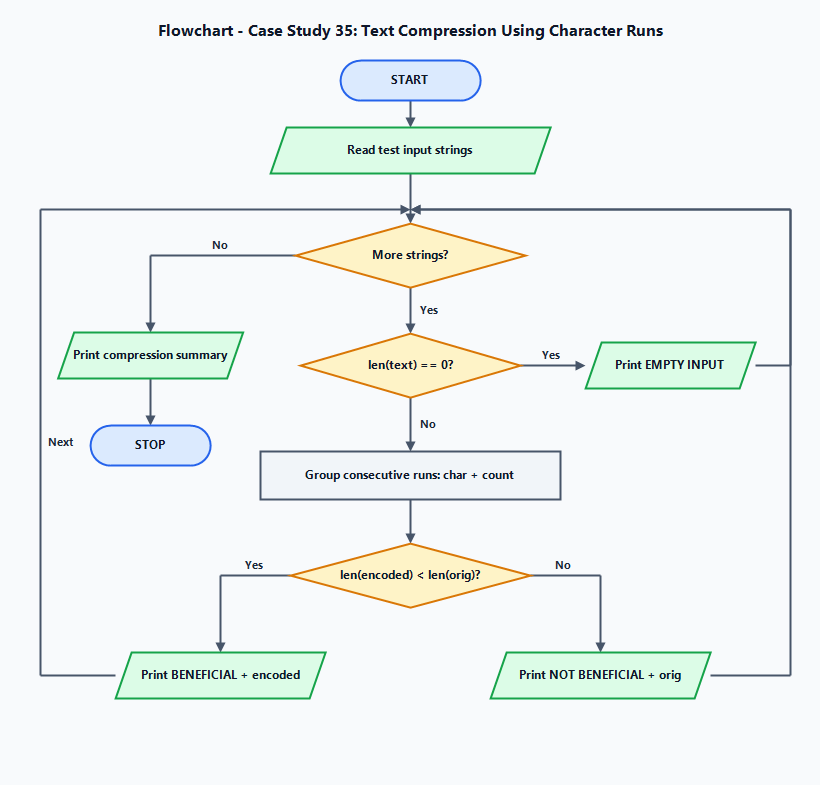
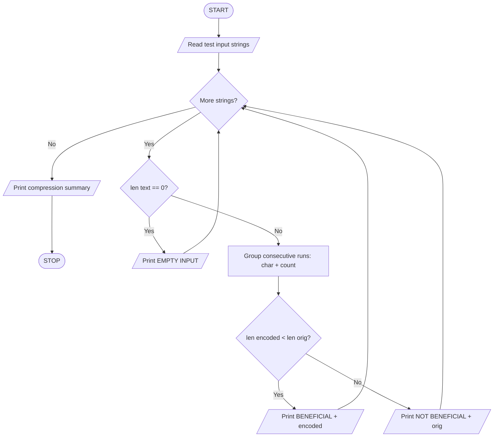
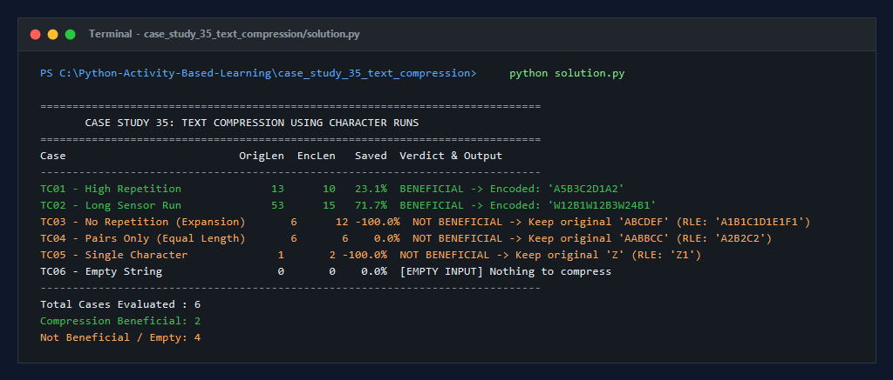

# Case Study 35: Text Compression Using Character Runs

## 1. Problem Statement
Develop a Python program that performs Run-Length Encoding (RLE) on input strings by grouping consecutive identical characters into `<char><count>` runs, comparing original and encoded lengths, calculating space savings, and identifying cases where compression is not beneficial.

---

## 2. Objectives
- Scan input strings sequentially using loops to group consecutive repeated characters.
- Encode runs into `<char><count>` format and store `(char, run_len)` tuples.
- Compare `orig_len` and `enc_len` to compute percentage savings.
- Flag non-beneficial encodings (`enc_len >= orig_len`) and handle edge cases such as empty strings and single characters.

---

## 3. Assumptions
- Input strings consist of non-numeric characters or general text where `<char><count>` accurately represents consecutive runs.
- Encoding is considered **beneficial** strictly when `len(encoded) < len(original)`.
- Empty strings (`""`) are reported as empty input without compression.

---

## 4. Algorithm
1. **Start** and initialize `beneficial_count = 0` and `not_beneficial_count = 0`.
2. Loop over each test tuple `(label, text)` in `test_strings`.
3. Compute `orig_len = len(text)`. If `orig_len == 0`, increment `not_beneficial_count`, print `[EMPTY INPUT]`, and continue.
4. Initialize `encoded = ""`, `runs_list = []`, and index `i = 0`.
5. While `i < orig_len`:
   - Set `current_char = text[i]` and `run_len = 1`.
   - While `(i + run_len) < orig_len` and `text[i + run_len] == current_char`, increment `run_len`.
   - Append `(current_char, run_len)` to `runs_list`, concatenate `current_char + str(run_len)` to `encoded`, and advance `i += run_len`.
6. Compute `enc_len = len(encoded)` and `savings_pct = ((orig_len - enc_len) / orig_len) * 100`.
7. If `enc_len < orig_len`, increment `beneficial_count` and mark `BENEFICIAL`; otherwise increment `not_beneficial_count` and recommend keeping the original string.
8. Print summary counts and **Stop**.

---

## 5. Flowchart





---

## 6. Pseudocode
```text
BEGIN
    SET beneficial_count = 0, not_beneficial_count = 0
    FOR each (label, text) IN test_strings DO
        SET orig_len = LENGTH(text)
        IF orig_len == 0 THEN
            INCREMENT not_beneficial_count
            PRINT label, "EMPTY INPUT"
            CONTINUE
        ENDIF

        SET encoded = "", i = 0
        WHILE i < orig_len DO
            SET current_char = text[i], run_len = 1
            WHILE (i + run_len) < orig_len AND text[i + run_len] == current_char DO
                run_len = run_len + 1
            ENDWHILE
            encoded = encoded + current_char + STR(run_len)
            i = i + run_len
        ENDWHILE

        SET enc_len = LENGTH(encoded)
        SET savings = ((orig_len - enc_len) / orig_len) * 100
        IF enc_len < orig_len THEN
            INCREMENT beneficial_count
            PRINT "BENEFICIAL", encoded, savings
        ELSE
            INCREMENT not_beneficial_count
            PRINT "NOT BENEFICIAL", text, encoded, savings
        ENDIF
    ENDFOR
    PRINT summary counts
END
```

---

## 7. Python Source Code
- Source file: [`solution.py`](solution.py)
- **Syllabus concepts applied:** Variables, strings, string indexing and concatenation, nested `while` loops, `for` loop, `str()` conversion, arithmetic operators, conditionals, lists, tuples, and tuple unpacking.

---

## 8. Test Cases

| Test ID | Input String | Expected Result | Observed Output | Status |
| :--- | :--- | :--- | :--- | :--- |
| TC01 | `"AAAAABBBCCDAA"` (len 13) | `"A5B3C2D1A2"` (len 10, `23.1%` saved, BENEFICIAL) | `EncLen=10`, `23.1%`, `BENEFICIAL` | PASS |
| TC02 | 53-char sensor string | `"W12B1W12B3W24B1"` (len 15, `71.7%` saved, BENEFICIAL) | `EncLen=15`, `71.7%`, `BENEFICIAL` | PASS |
| TC03 | `"ABCDEF"` (len 6) | `"A1B1C1D1E1F1"` (len 12, `-100.0%`, NOT BENEFICIAL) | `EncLen=12`, `-100.0%`, `NOT BENEFICIAL` | PASS |
| TC04 | `"AABBCC"` (len 6) | `"A2B2C2"` (len 6, `0.0%`, NOT BENEFICIAL) | `EncLen=6`, `0.0%`, `NOT BENEFICIAL` | PASS |
| TC05 | `"Z"` (len 1) | `"Z1"` (len 2, `-100.0%`, NOT BENEFICIAL) | `EncLen=2`, `-100.0%`, `NOT BENEFICIAL` | PASS |
| TC06 | `""` (len 0) | Handled safely as empty input | `[EMPTY INPUT] Nothing to compress` | PASS |

---

## 9. Output Screenshots



---

## 10. Conclusion
This case study implements Run-Length Encoding using fundamental string indexing and `while` loops while proving empirically when compression yields space savings versus when retaining the original text is optimal.
