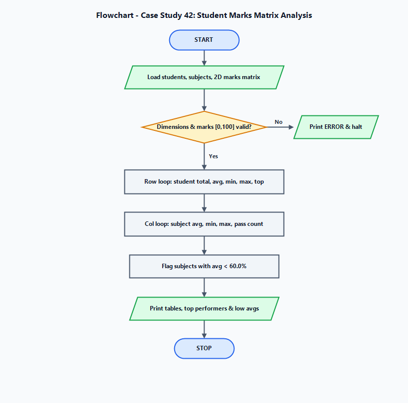
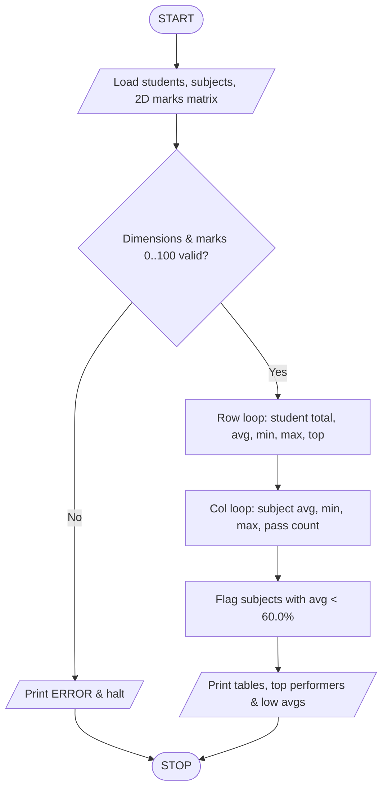
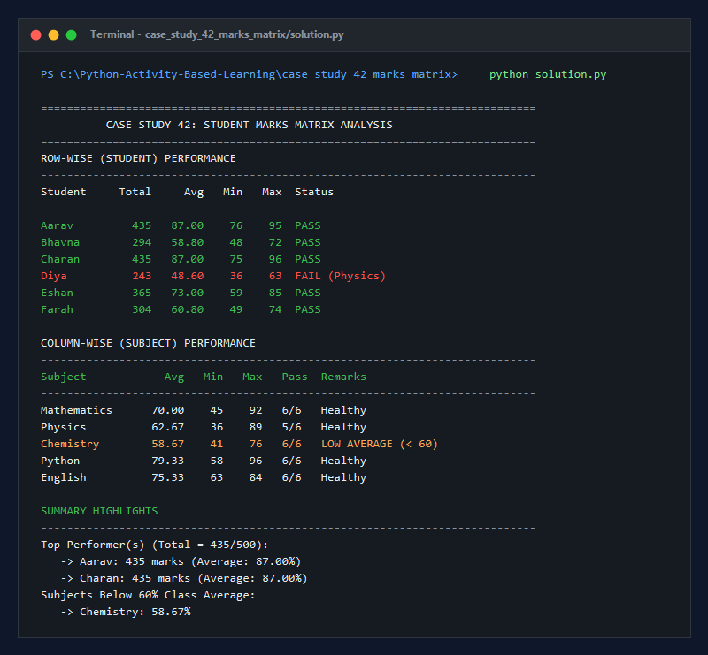

# Case Study 42: Student Marks Matrix Analysis

## 1. Problem Statement
Develop a Python program that analyses a 2D nested list (matrix) of student marks across multiple subjects, validates matrix dimensions and mark bounds (`0–100`), computes row-wise (student) and column-wise (subject) statistics, identifies top performers (including ties), and flags subjects with low average performance (`< 60%`).

---

## 2. Objectives
- Represent tabular student marks as a nested list (`marks_matrix[row][col]`) paired with student and subject lists.
- Validate matrix dimensions and ensure all marks fall in `[0, 100]`.
- Compute row-wise statistics (total, average, min, max, pass/fail subjects) per student.
- Compute column-wise statistics (average, min, max, pass count) per subject, detect tied top performers, and flag low-average subjects.

---

## 3. Assumptions
- Minimum passing mark in any subject is `40` out of `100`.
- A subject is flagged as **LOW AVERAGE** if its class mean is strictly below `60.0%`.
- Tied top performers (equal highest total marks) are all retained and reported.

---

## 4. Algorithm
1. **Start** and initialize `subjects`, `students`, and 2D nested list `marks_matrix`.
2. Validate that `len(marks_matrix) == len(students)`, every row has `len(subjects)` entries, and every mark satisfies `0 <= val <= 100`. If invalid, print error and **Stop**.
3. **Row-wise pass:** For each student row `r`:
   - Accumulate `s_total`, track `s_min`, `s_max`, and collect any `failed_subjects` (`mark < 40`).
   - Compute `s_avg = s_total / num_subjects` and print student row stats.
   - Update `highest_total` and `top_performers` list (appending on ties).
4. **Column-wise pass:** For each subject column `c`:
   - Loop through all rows `r` to compute `col_total`, `col_min`, `col_max`, and `pass_count` (`mark >= 40`).
   - Compute `col_avg = col_total / num_students`; if `col_avg < 60.0`, append `(subjects[c], col_avg)` to `low_avg_subjects`.
5. Print summary highlights (all top performers and low-average subjects) and **Stop**.

---

## 5. Flowchart





---

## 6. Pseudocode
```text
BEGIN
    LOAD subjects, students, marks_matrix
    VALIDATE dimensions AND 0 <= mark <= 100 for all entries
    IF NOT valid THEN PRINT "ERROR"; STOP ENDIF

    SET highest_total = -1, top_performers = []
    FOR r = 0 TO num_students - 1 DO
        SET s_total = 0, s_min = marks_matrix[r][0], s_max = marks_matrix[r][0], failed = []
        FOR c = 0 TO num_subjects - 1 DO
            m = marks_matrix[r][c]
            s_total = s_total + m
            UPDATE s_min, s_max
            IF m < 40 THEN APPEND subjects[c] TO failed ENDIF
        ENDFOR
        UPDATE highest_total and top_performers (handle ties)
        PRINT student row statistics
    ENDFOR

    SET low_avg_subjects = []
    FOR c = 0 TO num_subjects - 1 DO
        COMPUTE col_total, col_min, col_max, pass_count across all rows
        col_avg = col_total / num_students
        IF col_avg < 60.0 THEN APPEND (subjects[c], col_avg) TO low_avg_subjects ENDIF
        PRINT subject column statistics
    ENDFOR

    PRINT top_performers AND low_avg_subjects
END
```

---

## 7. Python Source Code
- Source file: [`solution.py`](solution.py)
- **Syllabus concepts applied:** Lists, 2D nested lists, nested `for` loops, `range()`, conditional statements, tuples, tuple unpacking, and formatted output.

---

## 8. Test Cases

| Test ID | Input / Scenario | Expected Behaviour | Observed Output | Status |
| :--- | :--- | :--- | :--- | :--- |
| TC01 | Aarav `[92, 88, 76, 95, 84]` & Charan `[91, 89, 75, 96, 84]` | Both total `435` (`87.00%`), tie preserved in top performers | Both Aarav & Charan listed at `435/500` | PASS |
| TC02 | Diya `[45, 36, 41, 58, 63]` | Fails Physics (`36 < 40`) | `FAIL (Physics)` | PASS |
| TC03 | Chemistry column `[76, 52, 75, 41, 59, 49]` | Mean `58.67 < 60.0`, flagged as low average | `Chemistry 58.67 LOW AVERAGE (< 60)` | PASS |
| TC04 | Python column `[95, 68, 96, 58, 85, 74]` | Mean `79.33`, `6/6` pass, `Healthy` | `Python 79.33 6/6 Healthy` | PASS |

---

## 9. Output Screenshots



---

## 10. Conclusion
Using nested lists and nested loops, the Student Marks Matrix Analysis cleanly extracts both student-level and subject-level insights from 2D academic data, handling tied top ranks and surfacing underperforming subjects automatically.
