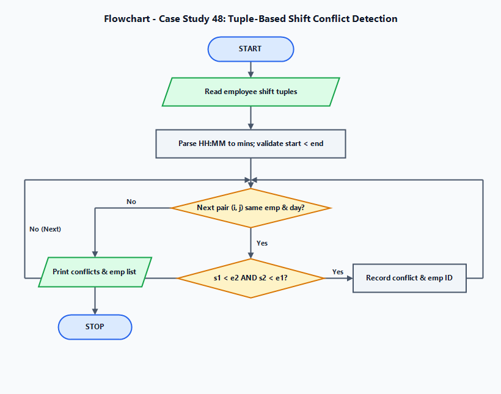
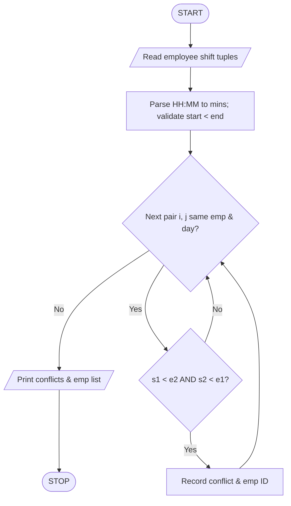
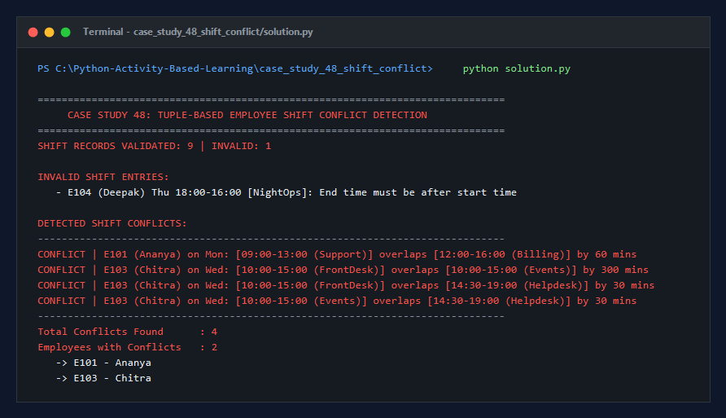

# Case Study 48: Tuple-Based Employee Shift Conflict Detection

## 1. Problem Statement
Design a Python program that stores employee work shifts as tuples `(emp_id, emp_name, day, start_time, end_time, department)`, parses and validates `"HH:MM"` time intervals, detects overlapping shift assignments on the same day for the same employee using nested loops, and lists all conflicts and affected employees.

---

## 2. Objectives
- Represent immutable shift records cleanly using tuples and tuple unpacking.
- Parse `"HH:MM"` strings via slicing (`[:2]`, `[3:]`) into integer minutes since midnight and validate clock bounds and `end_time > start_time`.
- Enrich valid tuples using tuple concatenation (`shift + (start_mins, end_mins)`).
- Compare shift pairs with nested loops to detect overlapping time intervals (`start1 < end2 and start2 < end1`) while permitting back-to-back shifts (`end1 == start2`).

---

## 3. Assumptions
- Shift times use 24-hour `"HH:MM"` format within a single calendar day (`00:00` to `24:00`).
- Back-to-back shifts sharing an exact boundary (e.g., `09:00–13:00` and `13:00–17:00`) are valid and **not** conflicts.
- Records with malformed timestamps, out-of-range hours/minutes, or `end_time <= start_time` are rejected and reported separately.

---

## 4. Algorithm
1. **Start** and load `shift_records` containing 6-element shift tuples.
2. Initialize `valid_shifts = []` and `invalid_shifts = []`.
3. For each `shift`, unpack `(emp_id, emp_name, day, start_str, end_str, dept)`.
4. Validate `HH:MM` structure, extract integer hours and minutes via string slicing, and compute `start_mins` and `end_mins`.
5. If clock fields are out of range or `end_mins <= start_mins`, append `(shift, reason)` to `invalid_shifts`; otherwise append `shift + (start_mins, end_mins)` to `valid_shifts`.
6. Use nested loops (`i` from `0` to `n-1`, `j` from `i+1` to `n-1`) to compare every pair of valid shifts.
7. If `id1 == id2` and `day1 == day2` and `s1 < e2 and s2 < e1`:
   - Compute `overlap_mins = min(e1, e2) - max(s1, s2)` via conditionals.
   - Append conflict details to `conflicts` and add unique employee identifier to `conflicted_employees`.
8. Print invalid shifts, detected conflicts, and unique affected employees, then **Stop**.

---

## 5. Flowchart





---

## 6. Pseudocode
```text
BEGIN
    SET valid_shifts = [], invalid_shifts = []
    FOR each shift IN shift_records DO
        UNPACK (emp_id, emp_name, day, start_str, end_str, dept)
        VALIDATE format "HH:MM"
        COMPUTE start_mins, end_mins using string slicing
        IF clock invalid OR end_mins <= start_mins THEN
            APPEND (shift, reason) TO invalid_shifts
        ELSE
            APPEND shift + (start_mins, end_mins) TO valid_shifts
        ENDIF
    ENDFOR

    SET conflicts = [], conflicted_employees = []
    FOR i = 0 TO LENGTH(valid_shifts) - 1 DO
        UNPACK shift i
        FOR j = i + 1 TO LENGTH(valid_shifts) - 1 DO
            UNPACK shift j
            IF id1 == id2 AND day1 == day2 AND s1 < e2 AND s2 < e1 THEN
                overlap_mins = MIN(e1, e2) - MAX(s1, s2)
                APPEND conflict details TO conflicts
                IF emp_label NOT IN conflicted_employees THEN APPEND emp_label TO conflicted_employees ENDIF
            ENDIF
        ENDFOR
    ENDFOR
    PRINT invalid_shifts, conflicts, conflicted_employees
END
```

---

## 7. Python Source Code
- Source file: [`solution.py`](solution.py)
- **Syllabus concepts applied:** Tuples, tuple concatenation (`+`), tuple unpacking, string slicing, nested `for` loops, `if`/`elif`/`else`, `in` membership check, and lists.

---

## 8. Test Cases

| Test ID | Shift Scenario | Expected Result | Observed Output | Status |
| :--- | :--- | :--- | :--- | :--- |
| TC01 | `E101` Mon `09:00–13:00` & `12:00–16:00` | Conflict (`60 mins` overlap) | `CONFLICT ... by 60 mins` | PASS |
| TC02 | `E101` Tue `09:00–13:00` & `13:00–17:00` | Touching boundary (`13:00`) allowed | No conflict reported | PASS |
| TC03 | `E102` Mon `08:30–12:30` & `14:00–18:00` | Disjoint shifts allowed | No conflict reported | PASS |
| TC04 | `E103` Wed 3 shifts (`10–15`, `10–15`, `14:30–19`) | 3 pairwise conflicts (`300`, `30`, `30` mins) | 3 conflicts logged for `E103` | PASS |
| TC05 | `E104` Thu `18:00–16:00` | Rejected as invalid interval | `INVALID: End time must be after start time` | PASS |

---

## 9. Output Screenshots



---

## 10. Conclusion
Tuple operations, string slicing, and pairwise nested-loop comparisons provide a clean and reliable engine for validating work schedules, distinguishing valid adjacent shifts from overlapping conflicts, and summarizing affected staff.
