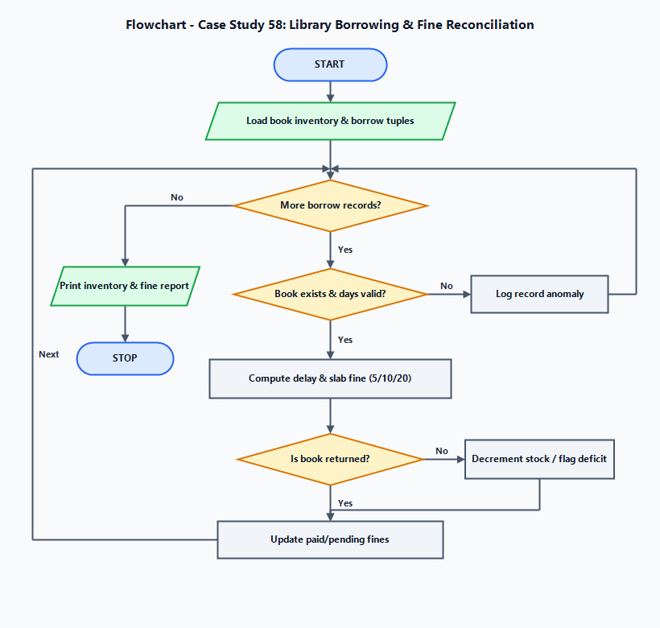
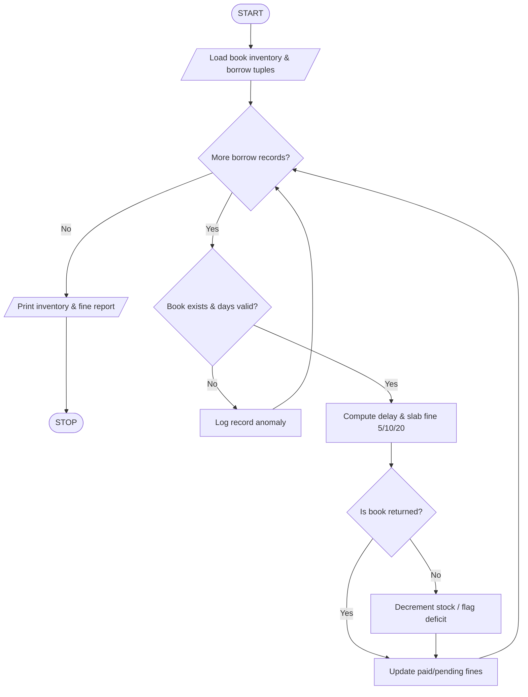
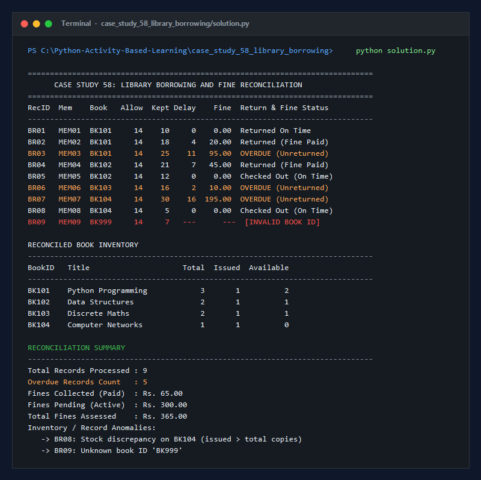

# Case Study 58: Library Borrowing and Fine Reconciliation

## 1. Problem Statement
Build a Python program that processes library borrowing tuples `(record_id, member_id, book_id, allowed_days, days_kept, is_returned)` against a book inventory list, calculates progressive overdue fines, tracks paid versus pending fines, flags unknown books or stock discrepancies, and reconciles final available book copies.

---

## 2. Objectives
- Represent borrowing events as tuples and mutable inventory counts as nested lists `[book_id, title, total_copies, available_copies]`.
- Calculate progressive overdue fines across three delay slabs (`1–5`, `6–10`, and `>10` days).
- Separate collected fines (returned books) from pending fines (unreturned overdue books).
- Reconcile current issued and available copies per book and flag anomalies (unknown book IDs, invalid day counts, or stock deficits).

---

## 3. Assumptions
- Progressive overdue fine slabs:
  - Days `1–5`: `Rs. 5.00 / day`
  - Days `6–10`: `Rs. 10.00 / day`
  - Days `> 10`: `Rs. 20.00 / day`
- Unreturned books reduce `available_copies` by `1` when stock permits; if `available_copies` is already `0`, a stock discrepancy anomaly is logged.
- Returned books leave inventory available count unchanged.

---

## 4. Algorithm
1. **Start** and initialize `books_inventory` (nested list) and `borrowing_records` (list of tuples).
2. Initialize `overdue_records = []`, `anomalies = []`, `collected_fines = 0.0`, `pending_fines = 0.0`.
3. Loop through each tuple `rec` in `borrowing_records` and unpack `(rec_id, mem_id, book_id, allowed_days, days_kept, is_returned)`.
4. Search `books_inventory` by `book_id`; if not found or day counts are invalid, log to `anomalies` and continue.
5. Compute `delay = max(0, days_kept - allowed_days)` and apply the progressive fine slabs (`5`, `10`, `20` Rs./day).
6. If `not is_returned`: decrement `available_copies` if `> 0`; else record a stock discrepancy in `anomalies`.
7. If `delay > 0`, append to `overdue_records`. Add `fine` to `collected_fines` if returned, else `pending_fines`.
8. After the loop, print the reconciled inventory table, fine totals, and anomalies, then **Stop**.

---

## 5. Flowchart





---

## 6. Pseudocode
```text
BEGIN
    INITIALIZE books_inventory, borrowing_records
    SET collected_fines = 0, pending_fines = 0, overdue_records = [], anomalies = []

    FOR each rec IN borrowing_records DO
        UNPACK (rec_id, mem_id, book_id, allowed_days, days_kept, is_returned)
        FIND book_index in books_inventory matching book_id
        IF book_index == -1 OR days_kept < 0 OR allowed_days <= 0 THEN
            APPEND anomaly TO anomalies
            CONTINUE
        ENDIF

        SET delay = MAX(0, days_kept - allowed_days)
        COMPUTE fine using progressive slabs (1-5: Rs.5, 6-10: Rs.10, >10: Rs.20)

        IF NOT is_returned THEN
            IF books_inventory[book_index][3] > 0 THEN
                DECREMENT books_inventory[book_index][3]
            ELSE
                APPEND stock discrepancy TO anomalies
            ENDIF
        ENDIF

        IF delay > 0 THEN APPEND record TO overdue_records ENDIF
        IF is_returned THEN collected_fines = collected_fines + fine
        ELSE pending_fines = pending_fines + fine ENDIF
    ENDFOR

    PRINT reconciled inventory, fine totals, anomalies
END
```

---

## 7. Python Source Code
- Source file: [`solution.py`](solution.py)
- **Syllabus concepts applied:** Lists, nested lists (mutating inventory counts in place), tuples, tuple unpacking, `for` loops, `break`, `continue`, conditional slabs, and boolean flags.

---

## 8. Test Cases

| Test ID | Borrow Record | Expected Outcome | Observed Output | Status |
| :--- | :--- | :--- | :--- | :--- |
| TC01 | `BR01`: `BK101`, kept 10/14, returned | Delay `0`, fine `0.00`, Returned On Time | `Delay=0`, `Fine=0.00` | PASS |
| TC02 | `BR04`: `BK102`, kept 21/14, returned | Delay `7` (`5*5 + 2*10 = 45.00`), Paid | `Delay=7`, `Fine=45.00`, `Returned (Fine Paid)` | PASS |
| TC03 | `BR07`: `BK104`, kept 30/14, unreturned | Delay `16` (`5*5 + 5*10 + 6*20 = 195.00`), Pending | `Delay=16`, `Fine=195.00`, `OVERDUE (Unreturned)` | PASS |
| TC04 | `BR08`: `BK104`, unreturned (only 1 copy total) | Stock discrepancy flagged (`issued > total`) | Anomaly logged on `BK104` | PASS |
| TC05 | `BR09`: `BK999` (non-existent) | Rejected as unknown book ID | `[INVALID BOOK ID]` & anomaly logged | PASS |

---

## 9. Output Screenshots



---

## 10. Conclusion
By combining immutable borrowing tuples with mutable nested inventory lists, the system accurately calculates tiered library fines, distinguishes realized from pending revenue, and reconciles physical stock discrepancies.
