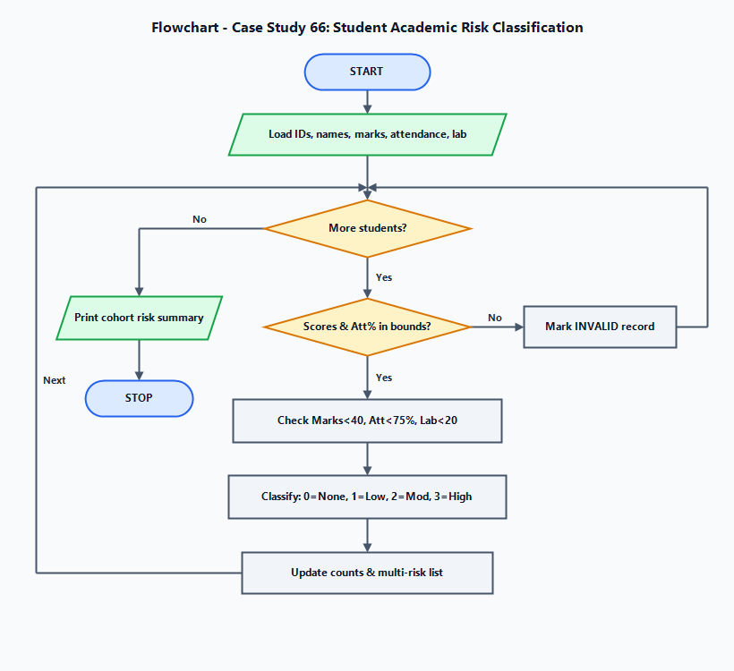
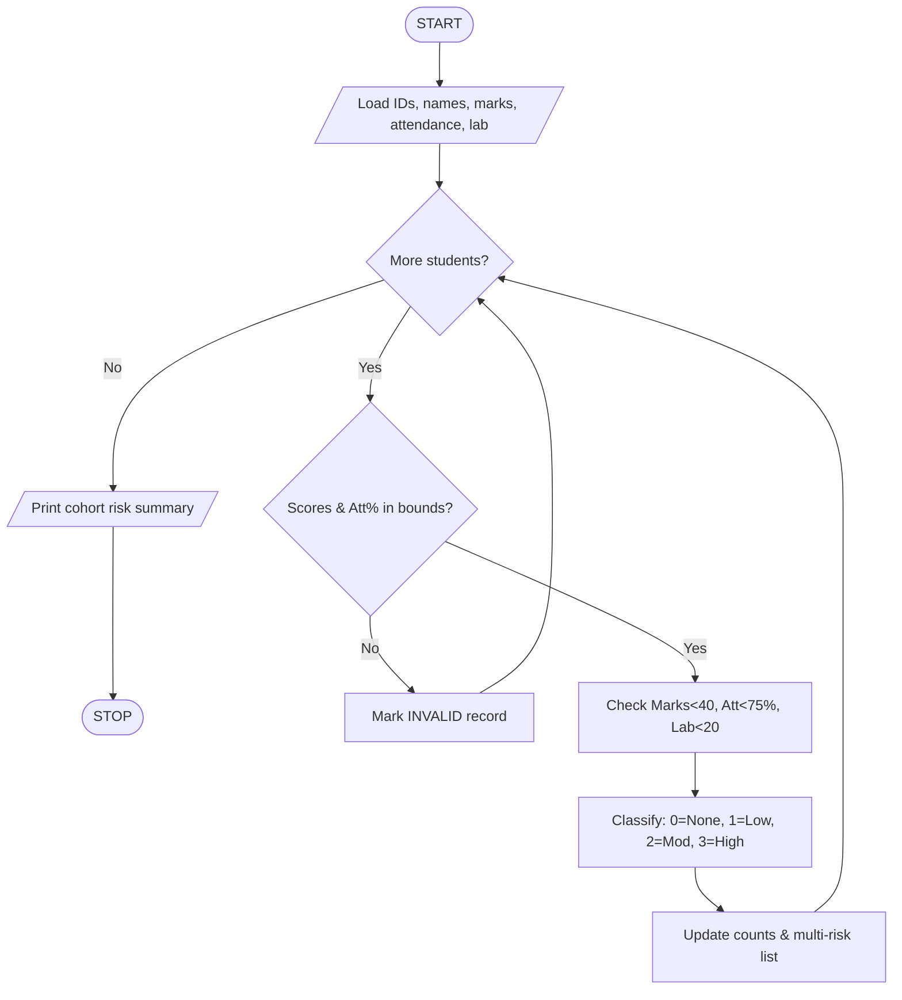
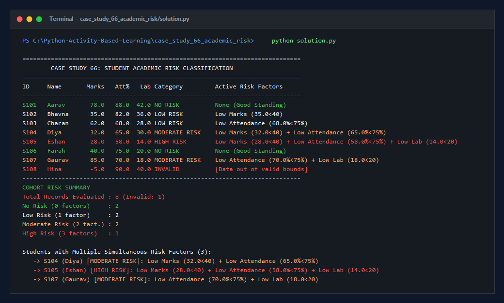

# Case Study 66: Student Academic Risk Classification

## 1. Problem Statement
Create a Python program that combines parallel lists of student IDs, names, theory marks, attendance percentages, and laboratory scores to validate academic data bounds, classify each student into risk categories (`NO RISK`, `LOW RISK`, `MODERATE RISK`, `HIGH RISK`), identify multiple simultaneous risk factors, and produce a cohort summary report.

---

## 2. Objectives
- Combine and iterate over parallel lists (`student_ids`, `student_names`, `theory_marks`, `attendance_pct`, `lab_scores`).
- Validate bounds (`0 <= marks <= 100`, `0 <= attendance <= 100`, `0 <= lab <= 50`).
- Evaluate three risk conditions (`marks < 40`, `attendance < 75%`, `lab < 20`) per student.
- Classify students by active risk count (`0`, `1`, `2`, `3`), isolate students with multiple simultaneous risk factors, and generate cohort totals.

---

## 3. Assumptions
- Risk factor thresholds:
  - Theory marks: `< 40.0` out of `100`
  - Attendance: `< 75.0%`
  - Laboratory score: `< 20.0` out of `50`
- Risk tiers: `0` factors = `NO RISK`, `1` = `LOW RISK`, `2` = `MODERATE RISK`, `3` = `HIGH RISK`.
- Exact threshold values (`40.0`, `75.0`, `20.0`) are treated as passing (`NO RISK`).

---

## 4. Algorithm
1. **Start** and initialize parallel lists (`student_ids`, `student_names`, `theory_marks`, `attendance_pct`, `lab_scores`).
2. Initialize category counters (`no_risk_count`, `low_risk_count`, `moderate_risk_count`, `high_risk_count`, `invalid_count`) and `multi_risk_students = []`.
3. Loop index `i` from `0` to `len(student_ids) - 1`.
4. Read `(sid, sname, marks, att, lab)` from index `i` across the parallel lists.
5. Validate ranges (`0..100` for marks/attendance, `0..50` for lab); if out of range, increment `invalid_count`, print `INVALID`, and continue.
6. Build `risk_factors = []` by checking `marks < 40`, `att < 75`, and `lab < 20`.
7. Determine `category` from `len(risk_factors)` (`0`, `1`, `2`, or `3`) and increment the corresponding counter.
8. If `len(risk_factors) >= 2`, append `(sid, sname, category, factors_text)` to `multi_risk_students`.
9. Print the student row, then after the loop print cohort totals and all multi-risk students, and **Stop**.

---

## 5. Flowchart





---

## 6. Pseudocode
```text
BEGIN
    LOAD student_ids, student_names, theory_marks, attendance_pct, lab_scores
    SET counts to 0, multi_risk_students = []

    FOR i = 0 TO LENGTH(student_ids) - 1 DO
        READ sid, sname, marks, att, lab AT index i
        IF marks NOT IN [0,100] OR att NOT IN [0,100] OR lab NOT IN [0,50] THEN
            INCREMENT invalid_count
            PRINT sid, "INVALID"
            CONTINUE
        ENDIF

        SET risk_factors = []
        IF marks < 40 THEN APPEND "Low Marks" TO risk_factors ENDIF
        IF att < 75 THEN APPEND "Low Attendance" TO risk_factors ENDIF
        IF lab < 20 THEN APPEND "Low Lab" TO risk_factors ENDIF

        SET fc = LENGTH(risk_factors)
        ASSIGN category ("NO RISK", "LOW RISK", "MODERATE RISK", "HIGH RISK")
        INCREMENT corresponding counter
        IF fc >= 2 THEN APPEND (sid, sname, category, risk_factors) TO multi_risk_students ENDIF
        PRINT student classification row
    ENDFOR

    PRINT cohort summary AND multi_risk_students
END
```

---

## 7. Python Source Code
- Source file: [`solution.py`](solution.py)
- **Syllabus concepts applied:** Parallel lists, list indexing, `for` loops, `range()`, `if`/`elif`/`else`, `.join()`, tuples, and tuple unpacking.

---

## 8. Test Cases

| Test ID | Student Record `(Marks, Att%, Lab)` | Expected Risk Tier | Observed Output | Status |
| :--- | :--- | :--- | :--- | :--- |
| TC01 | `S101` Aarav `(78.0, 88.0, 42.0)` | `NO RISK` (0 factors) | `NO RISK (None)` | PASS |
| TC02 | `S102` Bhavna `(35.0, 82.0, 36.0)` | `LOW RISK` (Marks `< 40`) | `LOW RISK (Low Marks)` | PASS |
| TC03 | `S104` Diya `(32.0, 65.0, 30.0)` | `MODERATE RISK` (2 factors) | `MODERATE RISK (Marks + Attendance)` | PASS |
| TC04 | `S105` Eshan `(28.0, 58.0, 14.0)` | `HIGH RISK` (all 3 factors) | `HIGH RISK (Marks + Attendance + Lab)` | PASS |
| TC05 | `S106` Farah `(40.0, 75.0, 20.0)` | `NO RISK` (exact boundary pass) | `NO RISK (None)` | PASS |
| TC06 | `S108` Hina `(-5.0, 90.0, 40.0)` | Rejected as out of bounds | `INVALID [Data out of valid bounds]` | PASS |

---

## 9. Output Screenshots



---

## 10. Conclusion
The Student Academic Risk Classification system synthesizes multi-source academic indicators into actionable risk categories, isolating students experiencing compounding academic difficulties (`MODERATE` and `HIGH RISK`) for early faculty intervention.
